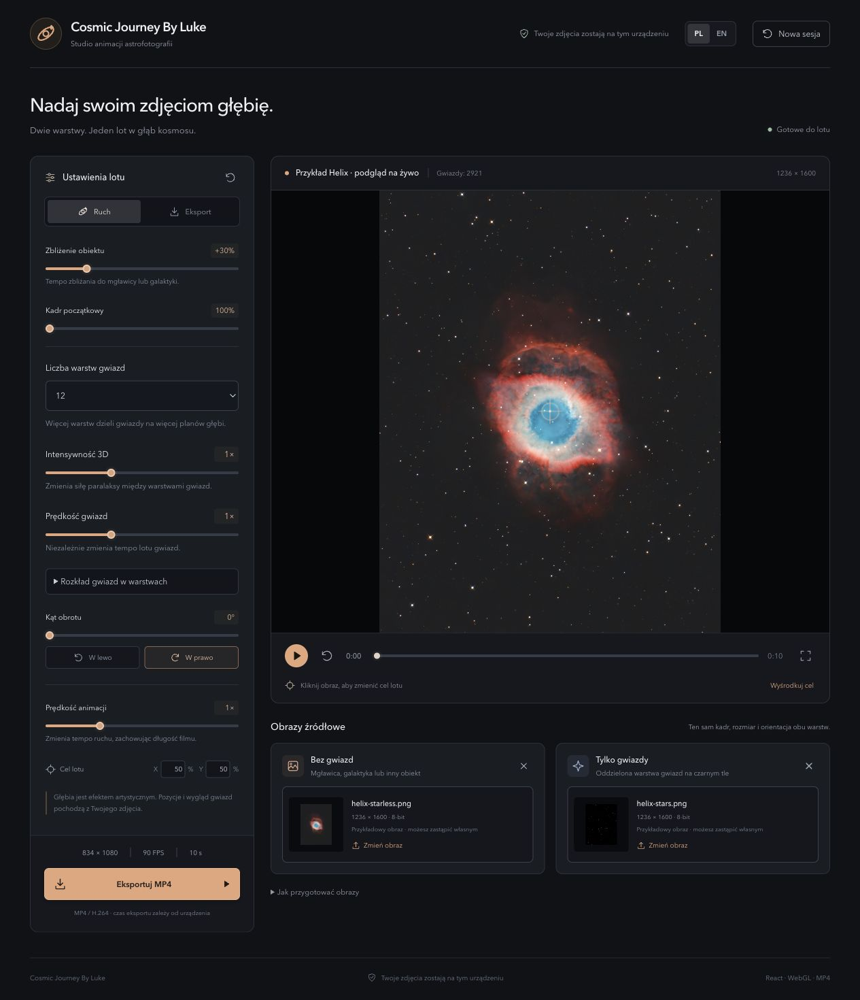
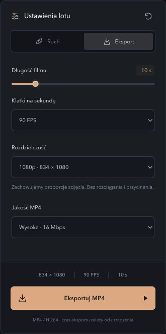
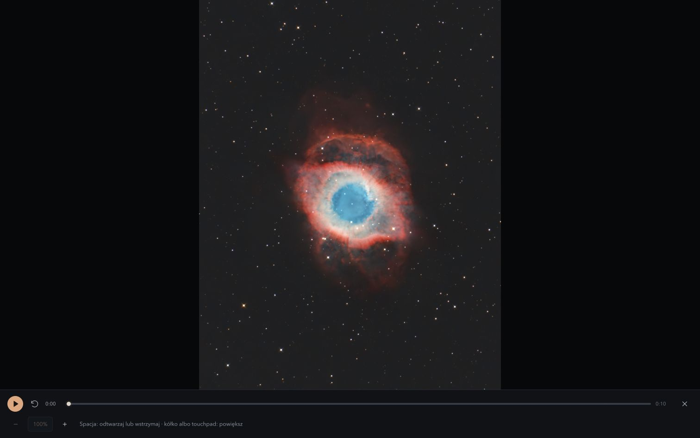

# Cosmic Journey By Luke

Create fly-through animations from astrophotography. Combine a starless image with a separate stars-only layer, adjust the motion, and export an MP4. Your images are processed on your device. The interface starts in English; select **PL** for Polish.

See [how it looks](#how-it-looks).

## Quick start

You need Docker with Docker Compose. Set `SITE_URL` to the HTTPS address where the app will be available, then start it:

```sh
export SITE_URL=https://comsicjourney.lukaszremkowicz.com
docker compose up -d --build
```

Open [http://localhost:8080](http://localhost:8080). Use `--build` after source changes to rebuild the image. Stop the app with `docker compose down`.

## Create a video

Select **Watch demo** in the header to watch a finished example video. Use the **Studio** editor to make a video from your own images:

1. In **Source images**, load a starless image and a stars-only image on a black background.
2. In **Motion**, adjust **Object zoom**, **Star layer count**, **3D intensity**, **Star speed**, and **Rotation angle**. Choose **Left** or **Right** for the rotation direction. Changes appear in the preview as you work. **Animation speed** changes how quickly the motion plays; it does not change the selected video duration.
3. Click the preview to choose the flight target, then select **Play** to watch the animation. Press **Space** to play or pause. In fullscreen, the mouse wheel or touchpad zooms the preview only; clicking the image does not move the flight target.
4. In **Export**, choose the **Video duration**, **Frames per second**, **Resolution**, and **MP4 quality**.
5. Select **Export MP4**. When the video is ready, select **Download MP4** to save it.

## Prepare your images

Use TIFF, PNG, JPEG, or WebP. Prepare two images with the same framing, dimensions, orientation, color settings, and histogram stretch: one without stars and one containing only stars on a black background. Display-ready images are recommended; linear TIFFs may look dark.

TIFF supports unsigned 8-bit or 16-bit samples and 32-bit floating-point samples. Floating-point values must be between 0 and 1. Files may be up to 512 MiB and 100 megapixels; processing is limited to a 4096-pixel longest edge. Video export uses 8-bit display data. The depth effect creates the impression of distance for the animation; it does not measure actual star distances.

MP4 export uses H.264 and requires a secure browser context: HTTPS or `localhost`. H.264 support and available frame rates and resolutions depend on your browser and device.

## Deploy to your own VPS

Production deployment requires Docker Compose v2.24.4 or newer, a running shared Traefik, and the external `traefik_proxy` network. With the app code already prepared on the VPS, run:

```sh
export DOMAIN=comsicjourney.lukaszremkowicz.com
./scripts/release/release.sh
```

Set `DOMAIN` to the hostname only, without `https://` or a path. The script builds the image and restarts the app, causing a brief interruption. It waits up to 60 seconds for an HTTP health check and removes unused images for this app. Run one release at a time; older images are not retained. See the [release script details](scripts/README.md).

## How it looks

Studio with motion and depth layers and two source images:



Export settings for duration, frame rate, resolution, and quality:



Fullscreen playback controls, the space shortcut, and zoom:


